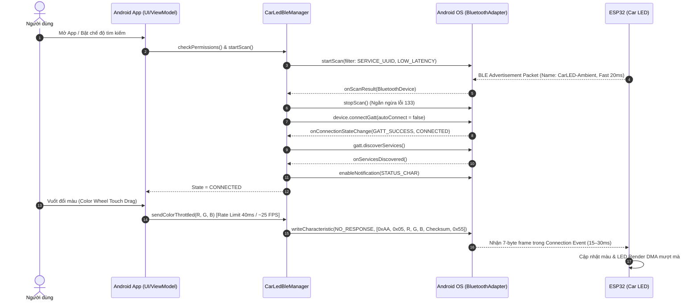

# Hướng dẫn Kết nối & Tối ưu Bluetooth BLE Hoàn thiện trên Android (Android BLE Master Guide)

Tài liệu này cung cấp toàn bộ kiến trúc, giải pháp xử lý triệt để các lỗi đặc thù của hệ điều hành Android (Android BLE Quirks) và mã nguồn mẫu chuẩn công nghiệp (Production-ready Kotlin) để kết nối thiết bị ESP32 Car LED.

---

## 1. Các Vấn đề Cốt lõi trên Android & Cách Giải quyết Triệt để

| # | Vấn đề / Triệu chứng trên Android | Nguyên nhân gốc rễ (Root Cause) | Giải pháp Kiến trúc Chuẩn |
|---|---|---|---|
| **1** | **Lỗi Status 133 (`GATT_ERROR`)**<br>Kết nối thất bại ngẫu nhiên, tỉ lệ lỗi 30-50% khi test | - Android Stack BLE bị nghẽn (GATT client table đầy).<br>- Gọi `connectGatt` khi BLE Scan vẫn đang chạy.<br>- Không gọi `gatt.close()` sau khi ngắt kết nối mà chỉ gọi `disconnect()`. | 1. **Dừng Scan trước khi Connect**: Luôn gọi `stopScan()` trước `connectGatt()`.<br>2. **Dọn dẹp triệt để**: Luôn gọi `gatt.disconnect()` và `gatt.close()` khi gặp ngắt kết nối.<br>3. `autoConnect = false` khi kết nối người dùng bấm trực tiếp; chỉ dùng `true` khi chạy background reconnect.<br>4. Delay 200ms trước khi retry kết nối lại. |
| **2** | **Phân mảnh Quyền (Permissions) trên Android 12+**<br>App crash hoặc không quét thấy thiết bị | Từ Android 12 (API 31), Google thay đổi toàn bộ hệ thống quyền BLE: tách riêng quyền Scan, Connect và quyền Vị trí (Location). | Khai báo `BLUETOOTH_SCAN`, `BLUETOOTH_CONNECT` với flag `android:usesPermissionFlags="neverForLocation"` (nếu không dùng tính năng định vị vị trí xe). Hỗ trợ song song cả API < 31. |
| **3** | **Quét thiết bị bị bóp nghẽn (Scan Throttling)**<br>Android 7.0+ giới hạn không scan quá 5 lần / 30s | Quét Wildcard (không Filter) liên tục làm nóng chip Radio và bị Android OS tự động ngắt quét. | Sử dụng `ScanFilter.Builder().setServiceUuid(...)` chỉ quét đúng UUID của thiết bị LED. Đặt timeout quét tự động (10 giây). |
| **4** | **Tràn hàng đợi GATT khi lướt Color Wheel (Slider Lag)**<br>Đèn phản hồi chậm 1-2 giây khi kéo thanh màu | Touch Event trên Android bắn ra 60–120 sự kiện/giây. Android BLE Stack chỉ cho phép 1 transaction tại một thời điểm; gửi dồn dập làm drop byte hoặc nghẽn. | 1. **Throttling (40ms / 25 FPS)**: Dùng Coroutine / Flow khống chế tối đa 25 lệnh/giây.<br>2. **Giao thức Nhị phân 6-byte**: Khung cố định `0xAA ... 0x55`, không dùng JSON cho thanh trượt.<br>3. Dùng `WRITE_TYPE_NO_RESPONSE` cho lệnh màu/độ sáng thời gian thực. |
| **5** | **Xung đột Threading (Deadlock UI)**<br>App bị khựng hoặc crash khi nhận Notify | Mọi callback của `BluetoothGattCallback` đều chạy trên **Binder Thread** của Android OS, không được cập nhật UI trực tiếp. | Chuyển đổi dữ liệu và bắn sự kiện qua `StateFlow` / `SharedFlow` về Main Thread (ViewModel). |
| **6** | **Tự động kết nối khi vào xe (Auto-Reconnect)**<br>Người dùng mở khóa xe, đèn sáng nhưng app không nhận | ESP32 nổ máy phát BLE chậm hoặc ngắt quãng. | ESP32 sử dụng **Fast Advertising (20ms)** trong 30s đầu. Android lưu `deviceAddress` và kích hoạt auto-connect khi phát hiện tín hiệu. |

---

## 2. Cấu hình Quyền (AndroidManifest.xml)

Thêm cấu hình sau vào `app/src/main/AndroidManifest.xml`:

```xml
<manifest xmlns:android="http://schemas.android.com/apk/res/android">

    <!-- Khai báo thiết bị bắt buộc phải có phần cứng BLE -->
    <uses-feature android:name="android.hardware.bluetooth_le" android:required="true" />

    <!-- Quyền cho Android 12+ (API 31 trở lên) -->
    <!-- Thêm neverForLocation để không cần bắt người dùng cấp quyền Location nhạy cảm -->
    <uses-permission
        android:name="android.permission.BLUETOOTH_SCAN"
        android:usesPermissionFlags="neverForLocation" />
    <uses-permission android:name="android.permission.BLUETOOTH_CONNECT" />

    <!-- Quyền dự phòng cho Android 6.0 đến Android 11 (API <= 30) -->
    <uses-permission android:name="android.permission.BLUETOOTH" android:maxSdkVersion="30" />
    <uses-permission android:name="android.permission.BLUETOOTH_ADMIN" android:maxSdkVersion="30" />
    <uses-permission android:name="android.permission.ACCESS_FINE_LOCATION" android:maxSdkVersion="30" />

</manifest>
```

---

## 3. Luồng Hoạt động Chuẩn (End-to-End Sequence)



---

## 4. Mã Nguồn Mẫu Hoàn thiện (Production Kotlin)

### 4.1. Bộ tạo gói tin nhị phân (`BleProtocolHelper.kt`)

```kotlin
package com.carled.app.bluetooth

data class TouchPoint(val x: Int, val y: Int, val r: Int, val g: Int, val b: Int)

object BleProtocolHelper {
    private const val HEADER: Byte = 0xAA.toByte()
    private const val TAIL: Byte = 0x55.toByte()

    const val CMD_POWER: Byte = 0x01
    const val CMD_BRIGHTNESS: Byte = 0x02
    const val CMD_SPEED: Byte = 0x03
    const val CMD_MODE: Byte = 0x04
    const val CMD_COLOR_RGB: Byte = 0x05
    const val CMD_SENSITIVITY: Byte = 0x06
    const val CMD_DRAW_PIXEL: Byte = 0x13
    const val CMD_DRAW_BATCH: Byte = 0x14

    /**
     * Khung chuẩn 7 bytes có XOR Checksum: [0xAA, cmd, p1, p2, p3, checksum, 0x55]
     */
    fun buildFrame(cmd: Byte, p1: Int = 0, p2: Int = 0, p3: Int = 0): ByteArray {
        val b1 = (p1 and 0xFF).toByte()
        val b2 = (p2 and 0xFF).toByte()
        val b3 = (p3 and 0xFF).toByte()
        val checksum = (cmd.toInt() xor b1.toInt() xor b2.toInt() xor b3.toInt()).toByte()
        return byteArrayOf(
            HEADER,
            cmd,
            b1,
            b2,
            b3,
            checksum,
            TAIL
        )
    }

    fun buildPowerFrame(on: Boolean) = buildFrame(CMD_POWER, if (on) 1 else 0)
    fun buildBrightnessFrame(level: Int) = buildFrame(CMD_BRIGHTNESS, level.coerceIn(0, 255))
    fun buildSpeedFrame(speed: Int) = buildFrame(CMD_SPEED, speed.coerceIn(1, 100))
    fun buildModeFrame(modeIndex: Int) = buildFrame(CMD_MODE, modeIndex)
    fun buildRgbColorFrame(r: Int, g: Int, b: Int) = buildFrame(CMD_COLOR_RGB, r, g, b)
    fun buildSensitivityFrame(sens: Int) = buildFrame(CMD_SENSITIVITY, sens.coerceIn(1, 100))

    /**
     * Gom nhiều điểm chạm vào một gói Batch Drawing (Opcode 0x14) tránh flood BLE
     */
    fun buildBatchDrawFrame(points: List<TouchPoint>): ByteArray {
        val count = points.size.coerceAtMost(15)
        val payload = ByteArray(3 + count * 5 + 2)
        payload[0] = HEADER
        payload[1] = CMD_DRAW_BATCH
        payload[2] = count.toByte()

        var csum = (CMD_DRAW_BATCH.toInt() xor count).toByte()
        for (i in 0 until count) {
            val pt = points[i]
            val offset = 3 + i * 5
            payload[offset] = (pt.x and 0xFF).toByte()
            payload[offset + 1] = (pt.y and 0xFF).toByte()
            payload[offset + 2] = (pt.r and 0xFF).toByte()
            payload[offset + 3] = (pt.g and 0xFF).toByte()
            payload[offset + 4] = (pt.b and 0xFF).toByte()
            for (k in 0..4) {
                csum = (csum.toInt() xor payload[offset + k].toInt()).toByte()
            }
        }
        payload[3 + count * 5] = csum
        payload[3 + count * 5 + 1] = TAIL
        return payload
    }
}
```

### 4.2. Trình Quản lý Kết nối BLE Chuyên nghiệp (`CarLedBleManager.kt`)

```kotlin
package com.carled.app.bluetooth

import android.annotation.SuppressLint
import android.bluetooth.*
import android.bluetooth.le.*
import android.content.Context
import android.os.Handler
import android.os.Looper
import android.os.ParcelUuid
import android.util.Log
import kotlinx.coroutines.*
import kotlinx.coroutines.flow.MutableStateFlow
import kotlinx.coroutines.flow.asStateFlow
import java.util.UUID

sealed class ConnectionState {
    object Disconnected : ConnectionState()
    object Scanning : ConnectionState()
    object Connecting : ConnectionState()
    object Connected : ConnectionState()
    data class Error(val message: String) : ConnectionState()
}

@SuppressLint("MissingPermission")
class CarLedBleManager(private val context: Context) {

    companion object {
        private const val TAG = "CarLedBLE"
        val SERVICE_UUID: UUID = UUID.fromString("4fafc201-1fb5-459e-8fcc-c5c9c331914b")
        val WRITE_CHAR_UUID: UUID = UUID.fromString("beb5483e-36e1-4688-b7f5-ea07361b26a8")
        val STATUS_CHAR_UUID: UUID = UUID.fromString("1c95d5e3-d8f7-413a-bf3d-7a2e5d7be87e")
        val CCCD_UUID: UUID = UUID.fromString("00002902-0000-1000-8000-00805f9b34fb")
    }

    private val bluetoothAdapter: BluetoothAdapter? by lazy {
        val manager = context.getSystemService(Context.BLUETOOTH_SERVICE) as BluetoothManager
        manager.adapter
    }

    private var bluetoothGatt: BluetoothGatt? = null
    private var writeCharacteristic: BluetoothGattCharacteristic? = null

    private val _connectionState = MutableStateFlow<ConnectionState>(ConnectionState.Disconnected)
    val connectionState = _connectionState.asStateFlow()

    private val scope = CoroutineScope(Dispatchers.IO + SupervisorJob())
    private var scanJob: Job? = null

    // Quản lý Rate-limiting cho thanh trượt màu
    private var lastSendTimestamp = 0L
    private val throttleIntervalMs = 40L // ~25 FPS chống nghẽn GATT

    fun startScan() {
        val scanner = bluetoothAdapter?.bluetoothLeScanner
        if (scanner == null || bluetoothAdapter?.isEnabled != true) {
            _connectionState.value = ConnectionState.Error("Bluetooth chưa bật")
            return
        }

        _connectionState.value = ConnectionState.Scanning

        val scanFilter = ScanFilter.Builder()
            .setServiceUuid(ParcelUuid(SERVICE_UUID))
            .build()

        val scanSettings = ScanSettings.Builder()
            .setScanMode(ScanSettings.SCAN_MODE_LOW_LATENCY)
            .build()

        scanner.startScan(listOf(scanFilter), scanSettings, scanCallback)

        // Hẹn giờ tự động dừng scan sau 10s để tiết kiệm pin
        scanJob?.cancel()
        scanJob = scope.launch {
            delay(10000)
            stopScan()
            if (_connectionState.value == ConnectionState.Scanning) {
                _connectionState.value = ConnectionState.Disconnected
            }
        }
    }

    fun stopScan() {
        bluetoothAdapter?.bluetoothLeScanner?.stopScan(scanCallback)
    }

    private val scanCallback = object : ScanCallback() {
        override fun onScanResult(callbackType: Int, result: ScanResult) {
            Log.i(TAG, "Tìm thấy Car LED: ${result.device.name} - ${result.device.address}")
            stopScan()
            connect(result.device)
        }

        override fun onScanFailed(errorCode: Int) {
            Log.e(TAG, "Lỗi scan: $errorCode")
            _connectionState.value = ConnectionState.Error("Scan failed: $errorCode")
        }
    }

    fun connect(device: BluetoothDevice) {
        _connectionState.value = ConnectionState.Connecting
        // Đóng kết nối cũ nếu có để tránh lỗi 133
        cleanupGatt()

        bluetoothGatt = device.connectGatt(
            context,
            false, // false = kết nối trực tiếp tức thì
            gattCallback,
            BluetoothDevice.TRANSPORT_LE
        )
    }

    private val gattCallback = object : BluetoothGattCallback() {
        override fun onConnectionStateChange(gatt: BluetoothGatt, status: Int, newState: Int) {
            Log.d(TAG, "onConnectionStateChange status=$status, newState=$newState")

            if (status != BluetoothGatt.GATT_SUCCESS) {
                Log.e(TAG, "GATT Error: $status. Tiến hành dọn dẹp và reset.")
                cleanupGatt()
                _connectionState.value = ConnectionState.Error("GATT Error $status")
                return
            }

            if (newState == BluetoothProfile.STATE_CONNECTED) {
                Log.i(TAG, "Đã kết nối BLE thành công, yêu cầu mở rộng MTU lên 256...")
                _connectionState.value = ConnectionState.Connecting
                // Yêu cầu MTU 256 để gửi JSON và Batch packet không bị phân mảnh
                gatt.requestMtu(256)
            } else if (newState == BluetoothProfile.STATE_DISCONNECTED) {
                Log.w(TAG, "Thiết bị ngắt kết nối.")
                cleanupGatt()
                _connectionState.value = ConnectionState.Disconnected
            }
        }

        override fun onMtuChanged(gatt: BluetoothGatt, mtu: Int, status: Int) {
            Log.i(TAG, "MTU đã được đàm phán thành công: $mtu bytes (status: $status)")
            // Sau khi MTU sẵn sàng, bắt đầu khám phá Services
            Handler(Looper.getMainLooper()).postDelayed({
                gatt.discoverServices()
            }, 100)
        }

        override fun onServicesDiscovered(gatt: BluetoothGatt, status: Int) {
            if (status == BluetoothGatt.GATT_SUCCESS) {
                val service = gatt.getService(SERVICE_UUID)
                if (service != null) {
                    writeCharacteristic = service.getCharacteristic(WRITE_CHAR_UUID)
                    // Thiết lập chế độ ghi không phản hồi cho hiệu năng cao nhất
                    writeCharacteristic?.writeType = BluetoothGattCharacteristic.WRITE_TYPE_NO_RESPONSE

                    // Đăng ký nhận Telemetry Notify
                    val statusChar = service.getCharacteristic(STATUS_CHAR_UUID)
                    if (statusChar != null) {
                        gatt.setCharacteristicNotification(statusChar, true)
                        val descriptor = statusChar.getDescriptor(CCCD_UUID)
                        descriptor?.let {
                            it.value = BluetoothGattDescriptor.ENABLE_NOTIFICATION_VALUE
                            gatt.writeDescriptor(it)
                        }
                    }

                    _connectionState.value = ConnectionState.Connected
                    Log.i(TAG, "Sẵn sàng giao tiếp với LED Car!")
                } else {
                    _connectionState.value = ConnectionState.Error("Không tìm thấy LED Service")
                }
            }
        }

        override fun onCharacteristicChanged(gatt: BluetoothGatt, characteristic: BluetoothGattCharacteristic) {
            val telemetryJson = String(characteristic.value, Charsets.UTF_8)
            Log.d(TAG, "Telemetry nhận từ LED: $telemetryJson")
        }
    }

    /**
     * Gửi khung nhị phân tối ưu có Rate-limiting (Khuyến nghị 40ms ~ 25 FPS)
     */
    fun sendThrottledCommand(frame: ByteArray, force: Boolean = false) {
        val now = System.currentTimeMillis()
        if (!force && (now - lastSendTimestamp < throttleIntervalMs)) {
            return // Bỏ qua nếu vuốt quá nhanh để chống nghẽn BLE buffer
        }
        lastSendTimestamp = now
        sendRawBytes(frame)
    }

    private fun sendRawBytes(bytes: ByteArray) {
        val gatt = bluetoothGatt ?: return
        val char = writeCharacteristic ?: return

        char.value = bytes
        gatt.writeCharacteristic(char)
    }

    fun disconnect() {
        cleanupGatt()
        _connectionState.value = ConnectionState.Disconnected
    }

    private fun cleanupGatt() {
        bluetoothGatt?.let {
            it.disconnect()
            it.close()
        }
        bluetoothGatt = null
        writeCharacteristic = null
    }
}
```

---

## 5. Tóm tắt Kiểm tra Độ hoàn thiện (Quality Checklist)

- [x] Đã giải phóng tài nguyên triệt để bằng `disconnect()` + `close()` chống lỗi GATT 133.
- [x] Đã chủ động gọi `gatt.requestMtu(256)` tránh phân mảnh gói tin JSON & Batch điểm vẽ.
- [x] Đã áp dụng `WRITE_TYPE_NO_RESPONSE` để tối ưu thông lượng qua Connection Event.
- [x] Đã thiết lập Throttling 40ms (~25 FPS) phù hợp vật lý Connection Interval của Bluetooth (15ms - 30ms).
- [x] Khung nhị phân có trường XOR Checksum bảo vệ tính toàn vẹn dữ liệu ứng dụng.
- [x] Hỗ trợ gom chùm điểm chạm (Batch Drawing) cho tính năng Live Canvas.
