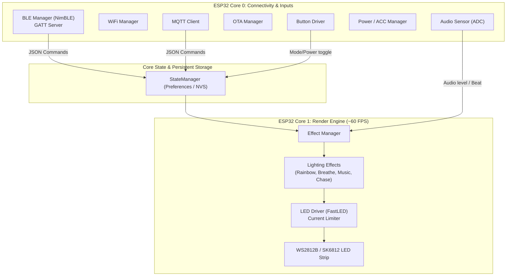

# Architecture Overview - IoT Device (Car LED Ambient)

Hệ thống Firmware cho thiết bị IoT điều khiển LED trang trí ô tô được thiết kế theo kiến trúc phân tầng (Layered Architecture) và tận dụng sức mạnh xử lý đa nhân (Dual-core FreeRTOS) của vi điều khiển ESP32.

---

## 1. Sơ đồ kiến trúc tổng thể

---

## 2. Phân chia tác vụ Đa nhân (Dual-Core FreeRTOS)

Để đảm bảo hiệu ứng LED chuyển động mượt mà, không bị giật lag khi có kết nối Bluetooth, Wi-Fi hoặc xử lý gói tin:

* **Core 1 (Dedicated LED Render Task):**
  * Chạy vòng lặp render hiệu ứng chuyên biệt với tần số cố định **60 FPS** (`vTaskDelayUntil`).
  * Thực hiện tính toán toán học, blending màu và đẩy xung tín hiệu RMT/PWM qua thư viện FastLED.
* **Core 0 (System, Connectivity & Sensor Loop):**
  * Duy trì kết nối Bluetooth Low Energy (BLE) với ứng dụng di động trong xe.
  * Xử lý Wi-Fi, MQTT và ArduinoOTA (nếu có kết nối Internet / Hotspot xe).
  * Lấy mẫu tín hiệu âm thanh từ Microphone (peak-to-peak sampling window).
  * Quét nút bấm vật lý và tín hiệu ACC từ ô tô.

---

## 3. Quản lý trạng thái & Bộ nhớ lưu trữ NVS

* Thiết bị sử dụng thư viện `Preferences` của ESP32 để lưu trữ vào phân vùng Non-Volatile Storage (NVS).
* Khi xe tắt máy (ACC ngắt), các thông số:
  * Trạng thái bật/tắt (Power On/Off).
  * Độ sáng (Brightness).
  * Tốc độ hiệu ứng (Speed).
  * Chế độ hiệu ứng đang chọn (Mode).
  * Màu sắc chủ đạo (Primary & Secondary RGB).
* Khi xe khởi động lại, thiết bị tự động khôi phục chính xác trạng thái chiếu sáng trước đó mà không cần người dùng kết nối lại điện thoại.
